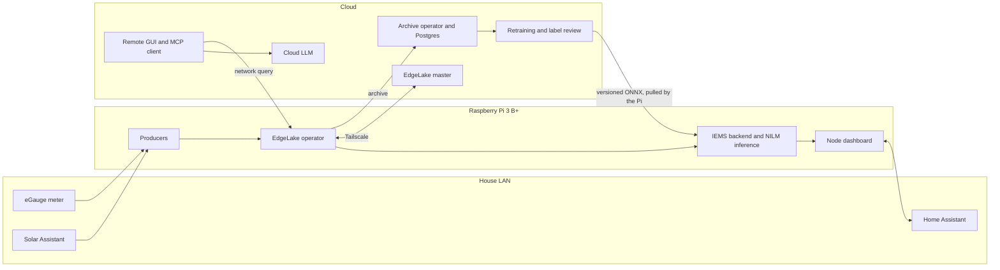

# iems-pi-edge

Edge and cloud split for a residential microgrid energy management system (IEMS).
A Raspberry Pi 3 Model B+ sits between the house and the cloud. It collects meter
and solar data, buffers it in a local EdgeLake operator, runs NILM inference and the
decision support engine, and serves the live dashboard on the house LAN. The cloud
holds the long-term archive, the AnyLog remote GUI, the language model behind the Ask box
and MCP client, and the retraining pipeline for the NILM models.

This repository is the design and deployment bundle for that move. It is written
against a live deployment that today runs as roughly a dozen Docker containers on a
single x86 desktop, and it records why each piece goes where it goes.

> Status: design complete, Phase 0 (Kafka removal on the existing host) ready to start.
> Nothing here has been deployed to a Pi yet. See [OUTLINE.md](OUTLINE.md) for the phase plan.

## Why

| Problem today | What this design does |
|---|---|
| The host uses about 2.8 GB of RAM and another 4.3 GB of swap | Removes Kafka, Kafka UI, the Kafka bridge, Grafana and the local LLM, which together account for about 3 GB |
| The house depends on one general-purpose desktop | Moves the always-on edge role onto a dedicated low-power board |
| The local 3B model answers slowly and sits in swap when idle | Replaces it with a cloud model reached over an API |
| Retraining needs GPU time the house does not have | Runs label review and retraining as batch jobs in the cloud |

## Placement at a glance



The full set of diagrams is in [architecture/](architecture/).

## Footprint on the Pi

Every node runs [EdgeLake](https://github.com/EdgeLake/EdgeLake), the open-source
distribution of AnyLog, natively on the Pi and from a pinned build in the cloud.

| | Value | Basis |
|---|---|---|
| EdgeLake operator RAM at the meter's rate | 96 to 99 MB | Measured |
| Whole Pi stack RAM | about 570 MB of 1 GB | Measured per service, OS from published figures |
| Software on the microSD card | about 4.6 GB of 16 GB | Measured environments, published OS size |
| Data written per day | about 305 MB | Measured, one full day built in EdgeLake's schema |
| Data held on the SSD | about 1.2 GB for three days | Derived from the daily figure |

Method and raw numbers: [docs/measurements/2026-10-09-edgelake.md](docs/measurements/2026-10-09-edgelake.md).
Budget: [docs/03-memory-budget.md](docs/03-memory-budget.md).

## Design principles

1. **The house keeps working without the internet.** Ingestion, inference, decision
   support, the dashboard and thermostat control all run on the Pi. Losing the uplink
   costs the archive, the GUI and the Ask box, never the live view.
2. **The cloud never reaches into the house.** The Pi pushes data out and pulls model
   updates in. No cloud service needs a route onto the home network.
3. **Measured and inferred evidence stay separate.** Every training label carries its
   provenance, and validation uses only measured or human-confirmed events.
4. **Measure before trusting an estimate.** Every memory figure in this repo is either
   measured on the live host or marked as an estimate with its source.

## Repository map

| Path | Contents |
|---|---|
| [OUTLINE.md](OUTLINE.md) | High-level outline, phases and acceptance criteria |
| [docs/](docs/) | Design documents, numbered in reading order |
| [docs/adr/](docs/adr/) | Architecture decision records |
| [docs/resources.md](docs/resources.md) | Annotated web resources and references |
| [architecture/](architecture/) | Mermaid diagrams for structure, data flow, deployment, retraining and failure handling |
| [streaming/](streaming/) | eGauge producer rewritten for the EdgeLake node's MQTT broker, and the matching message clients |
| [pi/](pi/) | Systemd units, OS hardening, install and benchmark scripts, environment template |
| [cloud/](cloud/) | Compose skeleton for the cloud side and the retraining pipeline outline |
| [sql/](sql/) | Schemas for user feedback and label provenance |

## Reading order

1. [docs/01-context.md](docs/01-context.md) for the system as it runs today, with measurements
2. [docs/02-architecture.md](docs/02-architecture.md) for the target design
3. [docs/03-memory-budget.md](docs/03-memory-budget.md) for RAM and disk, and why the Pi 3 B+ fits only without Docker
4. [docs/10-migration-plan.md](docs/10-migration-plan.md) for the order of work

## First things to run

On the existing host, before any Pi is involved:

```bash
# 1. Benchmark the deployed ONNX models (run again later on the Pi)
python3 pi/scripts/bench_onnx.py --models /path/to/services/iems/models --ticks 50

# 2. Replace Kafka with the MQTT producer (see docs/05-kafka-removal.md)
cp pi/config/edge.env.example .env   # fill in the meter URI and credentials
python3 streaming/egauge_mqtt_producer.py --dry-run
```

## Conventions

Site specifics stay out of the repository. Host addresses, the meter URI, the home
location, Home Assistant tokens and the panel to appliance mapping live in local
environment files that are gitignored. Every template in this repo ships with
placeholders.

Stored timestamps are UTC. Anything shown to a person is converted to Pacific time.

## Related repositories

`microgrid-manager` (branch `dev_fin`) holds the IEMS services, the NILM models and the
current single-host compose file. `gemma-anomaly` holds the anomaly assessment layer
that the cloud retraining pipeline reuses for label review.
