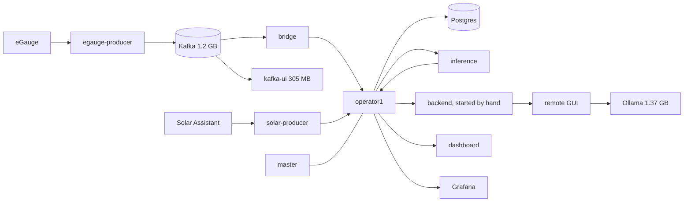
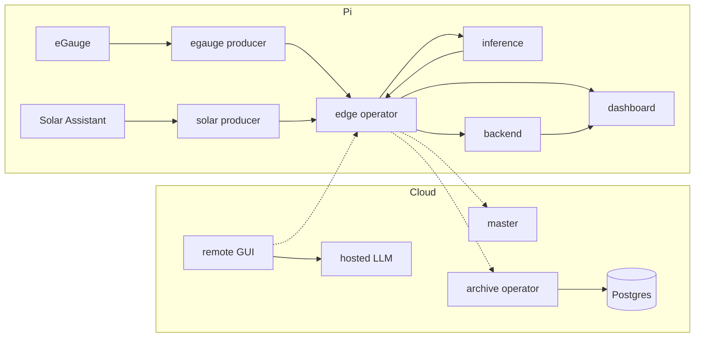

# Current versus target

## Current, one x86 host, about 2.8 GB RAM plus 4.3 GB swap

## Target, Pi plus cloud, about 570 MB on the Pi

| Removed | Moved to cloud | Stays at the edge |
|---|---|---|
| Kafka, Kafka UI, bridge, Grafana, Ollama | Master, Postgres archive, remote GUI, LLM | Producers, operator, inference, backend, dashboard |
