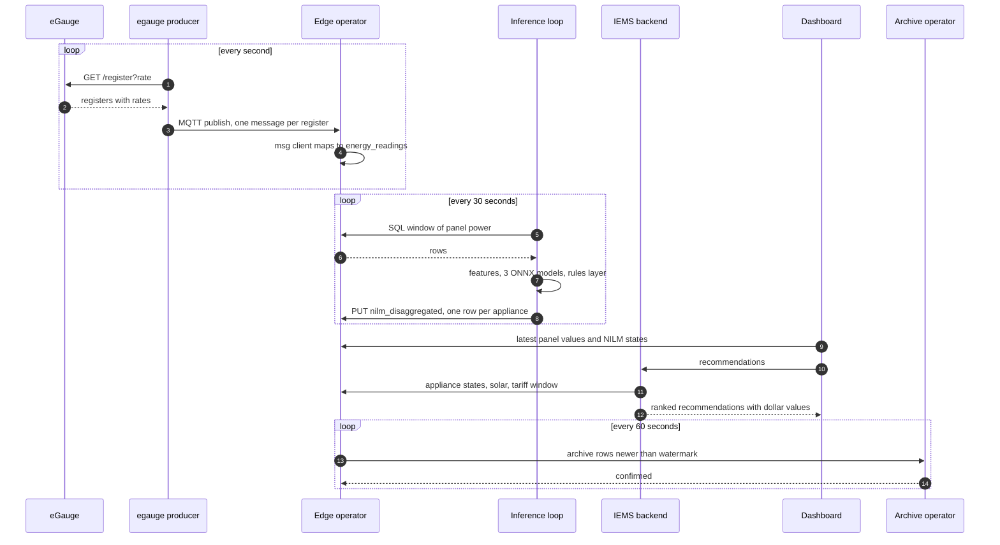

# Data flow

## A meter reading, end to end



## Tables

| Table | Written by | Read by | Rate |
|---|---|---|---|
| `energy_readings` | egauge producer | Inference, dashboard, archive | About 16 rows per second |
| `solar_data` | solar producer | Backend, dashboard, archive | One row every 5 seconds |
| `nilm_disaggregated` | Inference loop | Backend, dashboard, archive | 22 rows every 30 seconds, one per appliance head |
| `nilm_feedback` | Dashboard via backend | Archive, retraining | A few rows per day |
| `label_provenance` | Retraining pipeline, cloud only | Retraining | Batch |

## Message shapes

`energy_readings`, one message per register:

```json
{"ts": "2026-10-09 20:31:07.000000", "dev": "egauge-site", "nm": "Panel1", "tp": "P", "w": 412.7, "kwh": 0.0}
```

`nilm_disaggregated`, one row per appliance per tick. `state` is a string, `circuit`
names the panel, and the window columns describe the input the prediction came from.

```json
{"ts": "2026-10-09 20:31:30.000000", "circuit": "panel_3", "appliance": "appliance_a", "state": "on", "confidence": 0.91, "avg_w": 182.4, "median_w": 175.0, "std_w": 22.1, "window_start": "2026-10-09 20:19:30.000000", "window_end": "2026-10-09 20:31:30.000000", "window_n": 720}
```

The table has no model version column today. Adding `model_version` is part of
Phase 5 so that feedback and labels can be tied to the model that produced them.

Appliance names in examples are placeholders. The real panel to appliance mapping is
site-specific and lives in local configuration.
