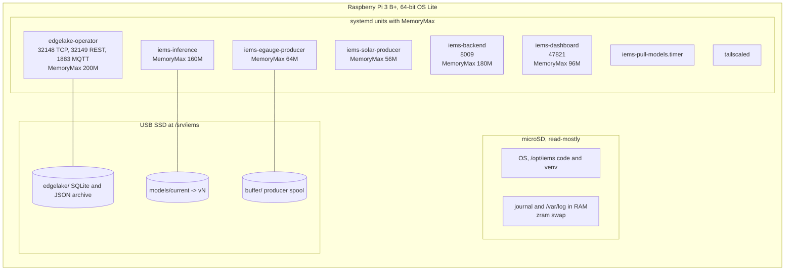
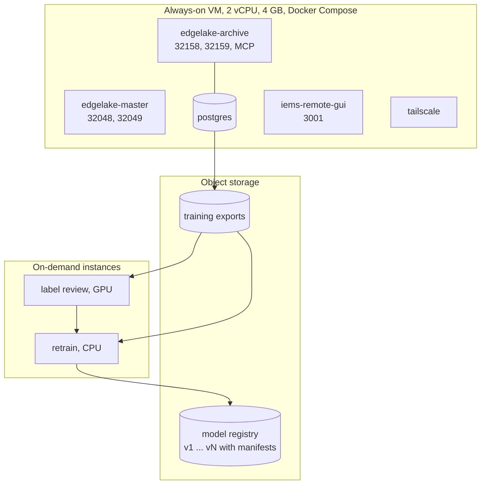

# Deployment

## Raspberry Pi

## Cloud

## Network

| From | To | Port | Path |
|---|---|---|---|
| Producers | Edge operator | 1883 | Loopback |
| Inference, backend, dashboard | Edge operator | 32149 | Loopback |
| Dashboard | Backend | 8009 | Loopback |
| Dashboard | Home Assistant | 8123 | House LAN |
| Household browsers | Dashboard | 47821 | House LAN |
| Edge operator | Master | 32048 | Tailnet |
| Edge operator | Archive operator | 32158 | Tailnet |
| GUI | Edge operator | 32149 | Tailnet |
| GUI IEMS plugin | Backend | 8009 | Tailnet |
| Model puller | Registry | 443 | Internet |
