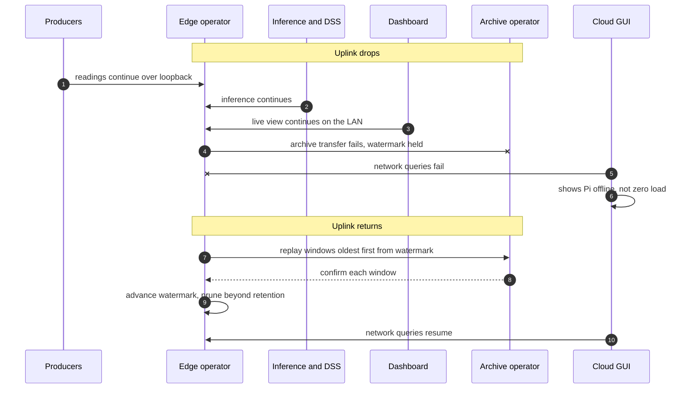

# Internet outage

The Pi's retention window must be longer than the longest outage it should survive
without loss. A few days of SQLite on the SSD covers ordinary outages. Longer ones
lose the oldest unarchived rows, and the healthcheck alerts before that happens.
