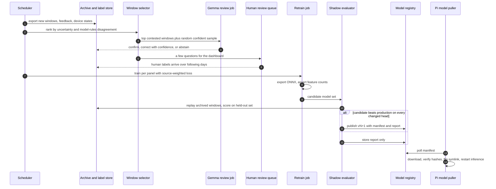
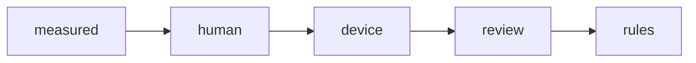

# Retraining flow

## Nightly cycle

## Label precedence

Read left to right as highest to lowest trust. At read time the most trusted label for
a window and appliance wins. Only measured, human and device labels enter the held-out
evaluation set.
