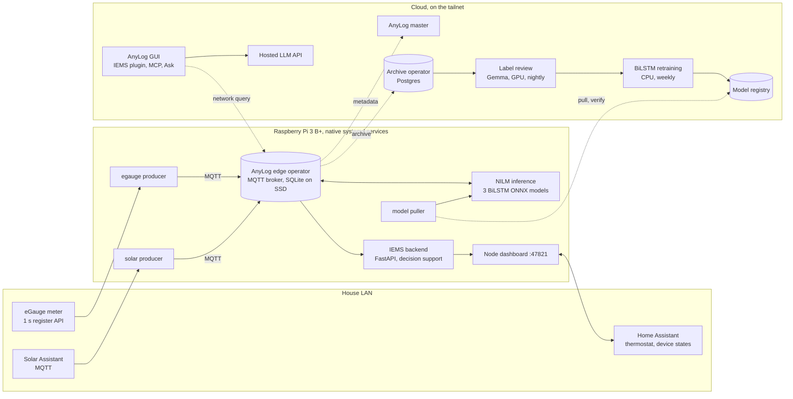

# System overview

Solid lines stay on one machine or the house LAN. Dashed lines cross the tailnet.
The Pi opens every tailnet connection except GUI queries, which reach only the Pi's
AnyLog REST port. Nothing in the cloud can reach Home Assistant or the meter.
