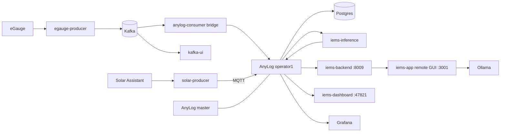

# 01. Context: the system as it runs today

## What the system does

The IEMS monitors a residential microgrid with rooftop solar, battery storage, a
backup generator and a utility tie. A revenue-grade meter reports panel-level power
once per second. A Solar Assistant instance reports PV output, battery state of charge
and inverter mode over MQTT. Home Assistant exposes the thermostat and other device
states on the LAN.

On top of that data the system runs three layers.

1. **NILM inference.** Three per-panel BiLSTM models, trained in PyTorch and exported
   to ONNX, estimate the on or off state of individual appliances from panel power.
   A physics-informed rules layer constrains their output.
2. **Decision support.** A FastAPI service turns appliance states, tariff windows,
   solar and battery state into dollar-denominated recommendations, following the
   four-domain architecture of Load, Generation, Storage and Decision Support.
3. **Interfaces.** A zero-dependency Node dashboard for the live view, the AnyLog
   remote GUI with an IEMS plugin, an MCP client and an Ask box backed by a language model.

## Current deployment

Everything runs on one x86 Ubuntu desktop as a single compose project, with one
exception: the IEMS backend container was started by hand and is not in the compose file.

## Measured memory, per container

Measured on the live host on 2026-10-09 from cgroup process membership, summing
resident memory and swap per container. Shared memory is double-counted for
multi-process containers, so the Postgres figure overstates its true footprint.

| Rank | Workload | RAM | Swap | Total |
|---|---|---|---|---|
| 1 | Ollama with a 3B instruct model loaded | 111 MB | 1261 MB | 1373 MB |
| 2 | Kafka broker, JVM with a fixed 1 GB heap | 950 MB | 253 MB | 1203 MB |
| 3 | AnyLog operator | 190 MB | 505 MB | 695 MB |
| 4 | Postgres, 12 backends | 366 MB | 8 MB | 375 MB |
| 5 | Docker daemon | 254 MB | 98 MB | 352 MB |
| 6 | Kafka UI, JVM | 182 MB | 122 MB | 305 MB |
| 7 | AnyLog remote GUI | 27 MB | 112 MB | 139 MB |
| 8 | IEMS backend, FastAPI | 9 MB | 90 MB | 100 MB |
| 9 | AnyLog master | 2 MB | 94 MB | 96 MB |
| 10 | Grafana | 67 MB | 13 MB | 81 MB |
| 11 | NILM inference loop | 28 MB | 52 MB | 80 MB |
| 12 | Node dashboard | 33 MB | 4 MB | 37 MB |
| 13 | Tailscale | 32 MB | 3 MB | 35 MB |
| 14 | eGauge producer | 25 MB | 2 MB | 27 MB |
| 15 | containerd | 21 MB | 4 MB | 25 MB |
| 16 | Kafka to AnyLog bridge | 11 MB | 13 MB | 24 MB |
| 17 | Solar producer | 14 MB | 2 MB | 16 MB |

Host totals at the same moment were 2.8 GB used of 7.6 GB RAM and 4.3 GB of swap in use.

### What the numbers say

Ollama and Kafka together are about 2.6 GB, more than half of everything. Ollama holds
the model resident even when the Ask box is idle, so most of it sits in swap. Kafka's
cost is fixed by design because the broker starts with a 1 GB heap reserved whether
or not it is busy. Neither is needed for the core job of ingesting, storing and
disaggregating meter data.

The workloads that actually define the system, the producers, inference, the backend
and the dashboard, total under 300 MB.

## Known issues carried into this design

| Issue | Effect | Where it is handled |
|---|---|---|
| IEMS backend not in compose | Not reproducible from the repo | Phase 0 |
| Dashboard sources handler pulls about 28,000 rows per poll | 24 s response on the host, would dominate a Pi 3 CPU | Phase 0 |
| Subpanel channels read negative while model normalization means are positive | Sign convention must be settled before retraining | Phase 1 |
| Decision support compares `state == 1` while state is stored as `'on'` | Zero recommendations | Phase 1 |
| Only 2 of 22 appliance heads have independent measurement | Remaining heads train on synthetic labels | [08-retraining-pipeline.md](08-retraining-pipeline.md) |
| AnyLog network routing returned empty because the ledger advertised the operator at 127.0.0.1 | Cross-host queries fail | [06-anylog-topology.md](06-anylog-topology.md) |
