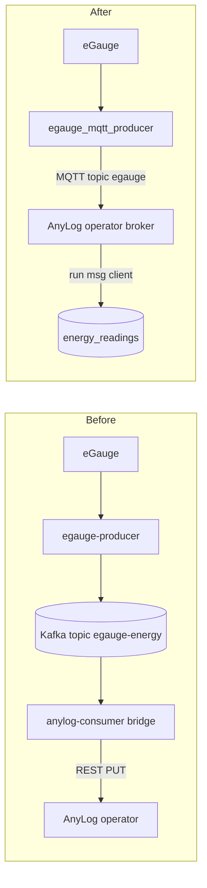

# 05. Removing Kafka

## Why

Kafka exists in the stack today only to carry meter readings from the producer to
AnyLog, through a separate bridge process. AnyLog already runs an MQTT broker, and the
solar producer already publishes to it directly. Kafka, Kafka UI and the bridge cost
about 1.5 GB of memory and add two failure points.

## Path today and after



## Message format

The producer keeps the same fields the Kafka path used, so the `energy_readings`
schema does not change.

| Field | Type | Example |
|---|---|---|
| ts | timestamp, UTC, no trailing Z | `2026-10-09 20:31:07.000000` |
| dev | string | `egauge-site` |
| nm | string, register name | `Panel1` |
| tp | single character register type | `P` |
| w | float, watts | `412.7` |
| kwh | float | `0.0` |

The trailing `Z` is dropped because AnyLog's streaming ingest has been seen to fail on
it. Timestamps stay UTC.

## Message client

[streaming/anylog_msg_client.al](../streaming/anylog_msg_client.al) registers the
mapping from topic `egauge` to `energy_readings`. It follows the same form as the
existing `solar` client.

## Cutover on the existing host

Run both paths in parallel for one day, then switch.

1. Register the `egauge` message client on the operator
2. Start `egauge_mqtt_producer.py` with `ANYLOG_TABLE=energy_readings_mqtt` for a parallel day
3. Compare row counts and per-register values between the two tables for the same window
4. Stop `egauge-producer`, `anylog-consumer`, `kafka-ui` and `kafka`
5. Switch the MQTT producer to `energy_readings` and remove the parallel client
6. Remove the three services and the `kafka_data` volume from compose

Never run `docker compose down` on the shared compose file. Stop services by name.

## Comparison query

```sql
SELECT nm, COUNT(*) AS n, AVG(w) AS mean_w
FROM energy_readings
WHERE ts >= '2026-10-10 00:00:00' AND ts < '2026-10-11 00:00:00'
GROUP BY nm ORDER BY nm;
```

Run the same query against the parallel table. Row counts per register should agree
within 1% and mean watts within 0.5%.

## Delivery guarantees

Kafka gave durable buffering between producer and bridge. MQTT at QoS 0 does not. The
producer compensates with a bounded on-disk spool: when the broker is unreachable,
messages are appended to a spool file on the SSD and replayed in order on reconnect.
Because the broker is local to the Pi, outages are short and mostly limited to operator
restarts.

## Rollback

Restart `kafka`, `egauge-producer` and `anylog-consumer`, and stop the MQTT producer.
The `energy_readings` table is shared by both paths, so no data migration is needed.
