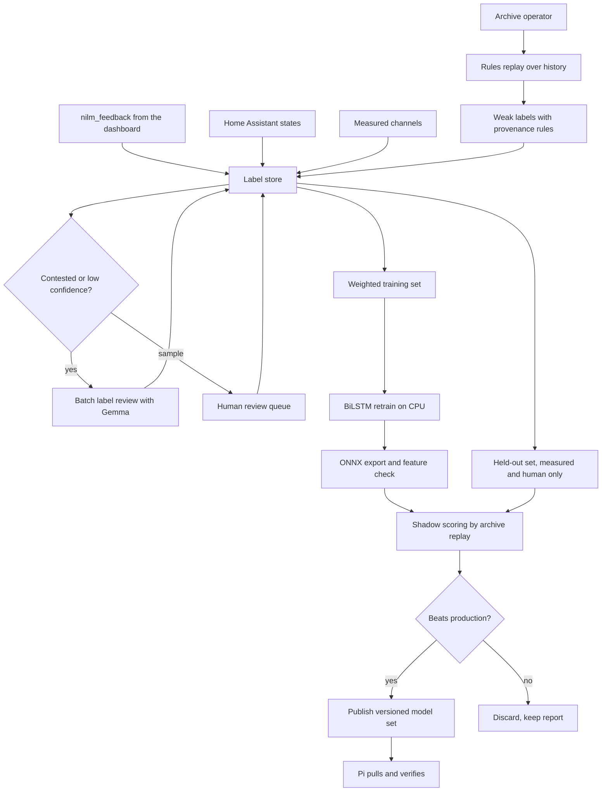

# 08. Cloud retraining pipeline

## Goal

Improve the NILM models and the physics-informed labeling rules using evidence that
does not come from the models or the rules themselves, then ship better models to the
Pi without ever pushing into the house.

## The constraint everything is built around

Only two of the 22 appliance heads have an independent measurement channel. The other
twenty train on labels generated by the rules layer. Agreement between the model and
the rules is therefore not confirmation of anything. A refined dataset built only from
model and rules output inherits their shared bias with more confidence attached.

Every label in this pipeline carries its provenance, and validation uses only labels
from outside the model and rules loop.

| Source | Example | Trust | Used for validation |
|---|---|---|---|
| measured | Dedicated channel for an appliance | Highest | Yes |
| human | Household confirmed or corrected an event | High | Yes |
| device | Home Assistant reported the device state | High | Yes |
| review | Language model review of a contested window | Medium | No |
| rules | Physics-informed labeler | Low | No |

## Flow

## Stages

### 1. Feedback capture on the Pi

The dashboard asks the household about a few uncertain events per day and records
answers in `nilm_feedback` ([sql/nilm_feedback.sql](../sql/nilm_feedback.sql)).
Three capture modes: confirm or reject a detected event, live tag ("starting the dryer
now"), and targeted questions chosen by uncertainty. Live tags are snapped to the
nearest matching power transition within a two-minute window. The table is archived to
the cloud like any other table.

### 2. Label store

[sql/label_provenance.sql](../sql/label_provenance.sql) holds one row per labeled
window per appliance, with source, confidence, model version and rules output at the
time. Labels are never overwritten. A newer label from a more trusted source supersedes
an older one at read time.

### 3. Selecting what to review

Rank windows by BiLSTM uncertainty (entropy or distance to threshold) plus a
disagreement score where model and rules differ. Favor appliances with the fewest
trusted labels. Send the top of the list to label review and a small random sample of
confident windows too, so the review model's error rate is measured rather than assumed.

### 4. Batch label review

A Gemma model reviews each selected window with measured and inferred evidence kept in
separate sections of the prompt, and either confirms, proposes a correction with a
confidence, or abstains. Abstention is a valid answer. The review reuses the snapshot
and prompt structure from `gemma-anomaly`.

Gemma 4 is the current generation, released in April 2026 in E2B, E4B, 26B mixture of
experts and 31B dense sizes, with a 12B unified model added in June 2026. The 26B
mixture of experts activates about 4B parameters per token, which suits a nightly batch.
Any adapter trained on an earlier Gemma generation must be retrained.

### 5. Training

Per-panel BiLSTM, fine-tuned from production weights with a lower learning rate. Loss
is weighted by label source. A replay buffer of original windows prevents forgetting
appliances that received no new labels. The models are small enough to train on CPU.

### 6. Export and checks

Export to ONNX, then read the artifact directly and assert the input feature count
matches the panel's JSON metadata. A constructor default once produced a model with the
wrong feature count, so this check is mandatory.

### 7. Shadow scoring and promotion

Replay archived windows through both the production and candidate models in the cloud,
score both against the held-out set, and promote only if the candidate wins on the
held-out set for every head it changes. Shadow scoring happens in the cloud so the Pi
never holds two model sets in memory at once.

### 8. Publishing and pulling

A promoted set is written to the registry as `v<N>/` with a manifest of file hashes,
feature counts and the evaluation report. The Pi runs
[pi/scripts/pull_models.sh](../pi/scripts/pull_models.sh) on a timer: download, verify
hashes, flip the `current` symlink, restart inference, keep the previous version.
Rollback is flipping the symlink back.

## Rules refinement

Confirmed events also refine the rules layer. For each appliance with enough confirmed
events, recompute rule parameters such as wattage bands, pulse spacing, minimum duration
and duty cycle as robust statistics over the confirmed events. Adopt new parameters only
if precision and recall improve on the held-out set. Then rerun the labeler over the
archive, which improves the synthetic labels for the whole history.

## Prerequisites

1. The subpanel sign convention is settled. A sign error in a curated dataset is much harder to remove later.
2. The decision support state type bug is fixed, so feedback on recommendations is meaningful.
3. Data may leave the house, per Phase 1.

Pipeline skeleton and configuration: [cloud/retraining/](../cloud/retraining/).
